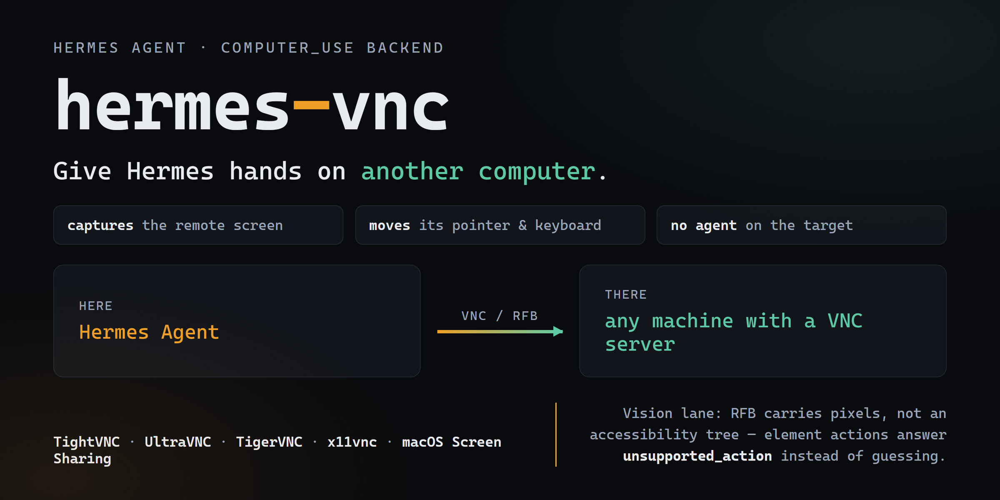

# hermes-vnc



**Give Hermes hands on another computer.** A `computer_use` backend for
[Hermes Agent](https://github.com/NousResearch/hermes-agent) that drives any machine
reachable over VNC (RFB): the stock `computer_use` tool captures that machine's screen and
moves its mouse and keyboard. Nothing has to be installed on the target except a VNC
server, and no Hermes process has to run there.

Select it once and the tool follows you:

```bash
hermes config set computer_use.backend hermes-vnc
```

## What it is for

A second desktop — a spare laptop, a lab box, a cloud Windows or Linux VM, a media PC, a
machine behind a screen you cannot sit in front of. VNC is the one remote-desktop protocol
every one of those already speaks, so a single backend reaches all of them.

The backend maps the `computer_use` contract onto RFB:

| Tool action | Over VNC |
|---|---|
| `capture` | PNG of the remote framebuffer, at its own pixel size |
| `click` / `drag` / `scroll` | pointer moves, button presses, wheel buttons 4-7 |
| `type_text` | keysyms for printable ASCII, Tab and Return |
| `key` | key combinations (`ctrl+s`, `cmd+space`, `alt+F4`) |
| `list_apps`, `list_windows` | empty — RFB has no application inventory |
| `focus_app`, `set_value`, click-by-element | `unsupported_action`, with what to do instead |

## Requirements

* Hermes Agent `>=0.23.0`.
* A VNC server on the machine you want to drive. Any of these work:
  TightVNC or UltraVNC (Windows), TigerVNC or `x11vnc` (Linux), Screen Sharing (macOS), or
  the VNC endpoint a cloud provider gives you.
* `vncdotool>=1.2,<2`, installed with the plugin (declared as `python_dependencies`).

## Install

```bash
hermes plugins install YAN-XBT/hermes-vnc --yes-deps
hermes plugins enable hermes-vnc          # installs the declared python_dependencies
hermes config set computer_use.backend hermes-vnc
hermes tools          # the computer_use row now names "VNC (remote desktop)"
```

**Enable it, do not just install it.** `python_dependencies` are installed by *enabling* the
plugin, and enabling builds a **new** pm environment that an already-running gateway or CLI
does not switch to. So the order is: install, enable, then **restart the host**
(`hermes gateway restart`, and restart the CLI). Without the restart the tool reports
`vncdotool is not installed` even though the environment now has it — `hermes plugins show
hermes-vnc` tells you which state you are in (`Status: enabled` or `Status: not enabled`).

## Configure

Point it at the target in `config.yaml`:

```yaml
computer_use:
  backend: hermes-vnc
  vnc:
    host: 192.168.1.42     # required; the machine running the VNC server
    port: 5900             # default 5900
    password_env: HERMES_VNC_PASSWORD   # variable holding the password (default)
    display_name: lab-pc   # optional label used in tool messages
    connect_timeout: 20    # seconds to wait for the RFB handshake
    call_timeout: 60       # seconds to wait for one protocol operation
    action_pause: 0.12     # seconds to let the remote compositor react
    max_capture_bytes: 12000000   # refuse a larger screenshot than this
    capture_max_width: 0   # 0 = native. See "Cutting what a capture costs" below.
```

### Cutting what a capture costs the model

Vision tokens scale with the **area of the image**, not with the file size, so `capture_max_width`
is the one setting that changes what a screenshot costs. Measured on a 1600×900 desktop:

| `capture_max_width` | image | est. tokens | vs native |
| --- | --- | --- | --- |
| `0` (native) | 1600×900 | 1920 | 100% |
| `1280` | 1280×720 | 1229 | 64% |
| `1024` | 1024×576 | 786 | 41% |
| `800` | 800×450 | 480 | 25% |
| `640` | 640×360 | 307 | 16% |

The catch is coordinate space. Click coordinates are **native desktop coordinates**, not image
pixels, so when the frame is downscaled the backend appends the factor to the capture's note
("multiply any position you read off this image by 2.0000 before acting"). That works, but it
is arithmetic the model has to get right, and a mis-scaled click lands somewhere else entirely.
Native is therefore the default; downscale when your screens are large and your budget is not.

Two costs this does *not* touch, because Hermes already handles them: a capture whose frame is
byte-identical to the previous one on the same target is not re-sent as an image at all, and
older images are evicted from the context as it fills.

The password is **not** read from `config.yaml`. Put it where Hermes keeps credentials —
in the profile's `.env`:

```
HERMES_VNC_PASSWORD=…
```

and it is resolved through Hermes' secret scope (`agent.secret_scope.get_secret`) under the
active profile, so a multiplexed gateway never picks up another profile's value.

Environment overrides, for pointing at another host without editing config:
`HERMES_VNC_HOST`, `HERMES_VNC_PORT`, `HERMES_VNC_PASSWORD_ENV`.

## Using it

Once `computer_use.backend` is `hermes-vnc`, ask in plain language:

> Capture the screen on lab-pc and tell me what is open.

> Click the "Export" button in the spreadsheet, then type the file name and press Enter.

> Press ctrl+s, then capture again and confirm the title bar lost its asterisk.

The model gets a screenshot and works in coordinates, exactly as it would with the built-in
driver.

## Watching it work — the live view

The tool path gives the *agent* still frames, because that is what an agent needs: look,
decide, act. A person watching wants the opposite, so the plugin ships a second, optional
surface for them — a pane in the Hermes Desktop app showing the remote screen continuously.

```
Ctrl+K / ⌘K → Show the remote screen pane     # docks beside the chat, in the right sidebar
Ctrl+K / ⌘K → Open the remote screen          # the full page, or Ctrl+Alt+V
```

It is **off by default**: enable it once in **Capabilities ▸ Plugins** and it stays off until
asked, like every desktop plugin.

How it works: `live_view.py` opens its **own** RFB connection to the same target, through the
same session code the tool uses, downscales each frame to 960 px wide and re-encodes it as
JPEG; `dashboard/plugin_api.py` serves those frames on the plugin's own backend namespace
(`/api/plugins/hermes-vnc/frame`), and the pane asks for one about every 350 ms. No new port is
bound, and nothing is captured until the pane asks for a frame.

Measured, so nobody is surprised by it: the frame rate is set by the round trip, not by the
plugin. The same code, the same 53 KB frames, two targets:

| Target | Per frame | Rate |
| --- | --- | --- |
| a **local** VNC server (loopback) | ~100 ms | **9.7 fps** |
| a cloud host over an **SSH tunnel** | ~1.1 s | 0.9 fps |

Each frame is a full-framebuffer request plus a round trip, so the tunnel is the whole story: a
LAN target is smooth, a distant one is a slideshow. Lowering `max_width` helps on the margin.

**Do not reach for `x11vnc -ncache`.** It is the usual advice for a slow live view, and here it
is actively wrong: `-ncache` assumes a client that implements the cache protocol, and this one
does not. Measured with it enabled, a frame took **11–23 s** — twenty times worse than without.

Two things worth knowing. The target must accept **more than one viewer at a time** — x11vnc
`-shared`, TightVNC, UltraVNC and macOS Screen Sharing all do by default, but a server
configured for a single viewer will drop the other connection. And the pane is a viewer, not a
second control channel: it never sends input.

## Limits — read these before relying on it

* **Pixels only.** RFB carries a framebuffer, not an accessibility tree, so there are no
  element indices, roles or labels. Every action is by coordinate, and the backend says so
  in `capture`'s note rather than pretending otherwise.
* **Input is foreground.** There is no background delivery over VNC: the remote pointer
  really moves and whatever the remote machine has focused receives the keys. That is why
  the results report `delivery_mode: foreground`.
* **Typing is ASCII.** Keystrokes are X11 keysyms, which covers printable ASCII, Tab and
  Return. Text inside Latin-1 but outside ASCII is sent as clipboard text (the remote
  machine has to paste it). Anything outside Latin-1 — Cyrillic, Greek, CJK — is refused
  with `unsupported_text`: RFB's cut-text message is Latin-1, so there is no honest way to
  type it through this protocol.
* **No window management.** `focus_app`, `set_value` and element-addressed actions cannot
  be honoured; bring a window forward with a click or a key combination instead.
* **One session per Hermes session.** The backend opens one connection when the tool first
  runs and closes it at the end of the session.
* **`plugins.isolation: host` refuses it.** Computer-use providers hand back live driver
  sessions, so Hermes loads them in-process only. Under `plugins.isolation: host` a
  user-installed provider cannot be loaded — a host rule that applies to every
  computer-use provider, not just this one.

Check the target before blaming the plugin:

```bash
hermes computer-use doctor     # runs this provider's doctor(): target, dependency, reachability
```

## Disclosure

What a user should know before installing, per the catalog's disclosure rule:

* **Network.** The plugin connects to the VNC server you configure — `computer_use.vnc.host`
  and `.port` — and sends screenshots and input to it. It contacts no other host, and it
  makes no request at all until the `computer_use` tool is used.
* **Credentials.** One: the VNC password, read from the variable named by `password_env`
  through Hermes' secret scope. It is never written to disk by the plugin and never logged.
* **Shell.** None. The plugin never spawns a process.
* **Files.** It reads none of yours. Screenshots live in memory and are handed to Hermes as
  base64 in the tool result; the plugin writes no files of its own.
* **Background processes.** One daemon thread runs Twisted's reactor, started on first
  connect and deliberately never stopped: the reactor is process-wide and cannot be
  restarted, so stopping it would break every later session in the same Hermes process.
* **Live view (optional, off by default).** When enabled, the desktop pane holds a **second**
  RFB connection to the same target and asks it for a frame about three times a second. Frames
  are downscaled and JPEG-encoded in memory and are never written to disk. The pane sends no
  input — it is a viewer. Disabling the pane stops the polling and the connection closes with
  the session.
* **UI surface.** The desktop half registers a pane, a page, a sidebar entry, two palette
  commands and one rebindable hotkey, and it uses nothing but the plugin SDK. It contributes
  nothing while disabled.
* **Telemetry.** None, of any kind.
* **Dependency.** `vncdotool>=1.2,<2`, pinned with an upper bound.

## Tests

Six suites, each runnable with or without pytest, using the interpreter `hermes` itself
uses. 103 tests in total; none of them needs a VNC server or a network, and the four live
suites start their own scripted RFB server on loopback.

```bash
# The interpreter the Hermes launcher runs on — `hermes pm env` prints the environment, and
# its venv is what matters. Using a different one makes Hermes' bootstrap re-exec the test
# process into a runtime of its own choosing.
PY=<HERMES_HOME>/installs/<hash>/environments/<hash>/venv/Scripts/python.exe

# 40 tests — the backend against a recording fake session: capture, pointer, drag, wheel,
# keysym typing, key combinations, the documented refusals, config and secret resolution, and
# the capture downscaler (geometry, the scale note, and falling back to native on failure)
"$PY" tests/test_hermes_vnc.py

# 30 tests — the edges: session timeouts and Deferred errbacks, eight threads driving one
# backend, reopening after a dead session, negative and non-numeric coordinates, scroll
# clamping, mixed-script typing, port and cap validation
"$PY" tests/test_hermes_vnc_edge_cases.py

# 2 tests — the real client against a scripted RFB server: handshake, framebuffer, pointer,
# keysyms, wheel buttons, cut text
"$PY" tests/test_live_rfb.py

# 5 tests — the failure modes: a server that dies mid-session, a growing framebuffer, a
# rejected password, and a server that hangs up during the handshake
"$PY" tests/test_live_rfb_edge_cases.py

# 16 tests — fault injection: a port speaking another protocol, a close before the banner, a
# silent server, a slow banner, a truncated auth challenge, a drop after authentication, a
# truncated framebuffer, a server dying mid-typing, reconnects, and two backends side by side
"$PY" tests/test_live_rfb_faults.py

# 10 tests — the live view's frame source: the downscaler's geometry, the config and
# dead-target errors, one connection reused across frames, reopening after a close, and two
# targets not sharing a session
"$PY" tests/test_live_view.py
```

### Verifying the tool layer

The suites above drive the backend. The layer above it — provider selection, the approval
gate, the multimodal result — is exercised by asking Hermes itself, with this plugin
selected and a VNC server reachable:

```bash
hermes config set computer_use.backend hermes-vnc
hermes chat -q "Use computer_use to capture the screen and tell me its exact pixel size."
```

Driving that against a live TightVNC server returned `2560x1440` for a 2560x1440 desktop,
with the capture arriving as an image part rather than JSON. The tool layer is deliberately
not covered by a script in this directory: `handle_computer_use` pulls in Hermes' bootstrap,
which re-executes any process started under a different interpreter, so a bare script cannot
hold that layer still long enough to assert on it.


## Why the session is not `vncdotool.api.connect`

That helper is documented as EXPERIMENTAL, and on vncdotool 1.4.2 its threaded proxy
resolves the live protocol for the first call only: every later call reaches a `None`
protocol and dies with `'NoneType' object has no attribute 'transport'`. Measured against a
scripted RFB server — `keyEvent(down=True)` succeeded and `keyEvent(down=False)` on the same
connection failed. `session.py` therefore starts the reactor itself, keeps the protocol
instance the factory hands back, and marshals each call onto the reactor thread with its own
completion event.

## License

MIT — see [LICENSE](LICENSE).
